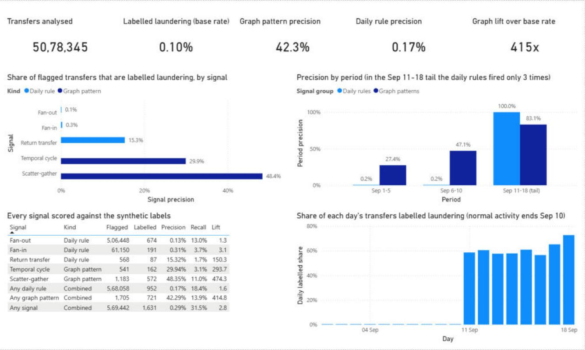
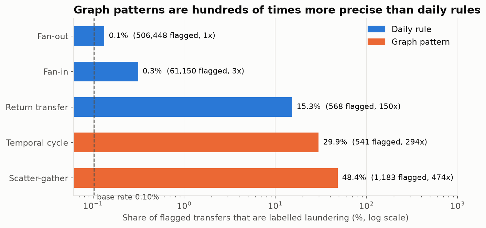
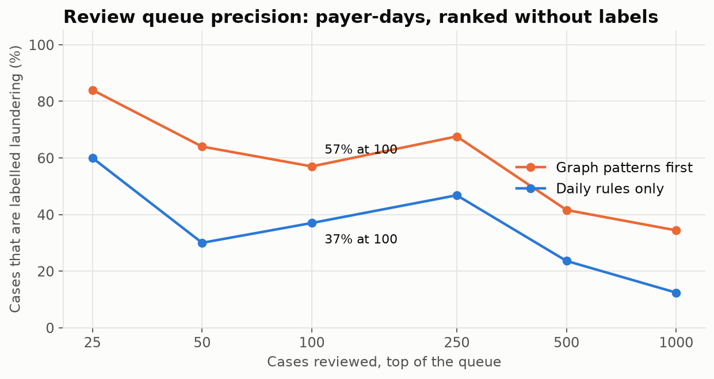
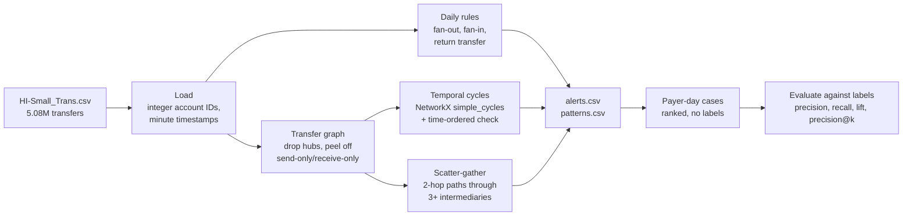
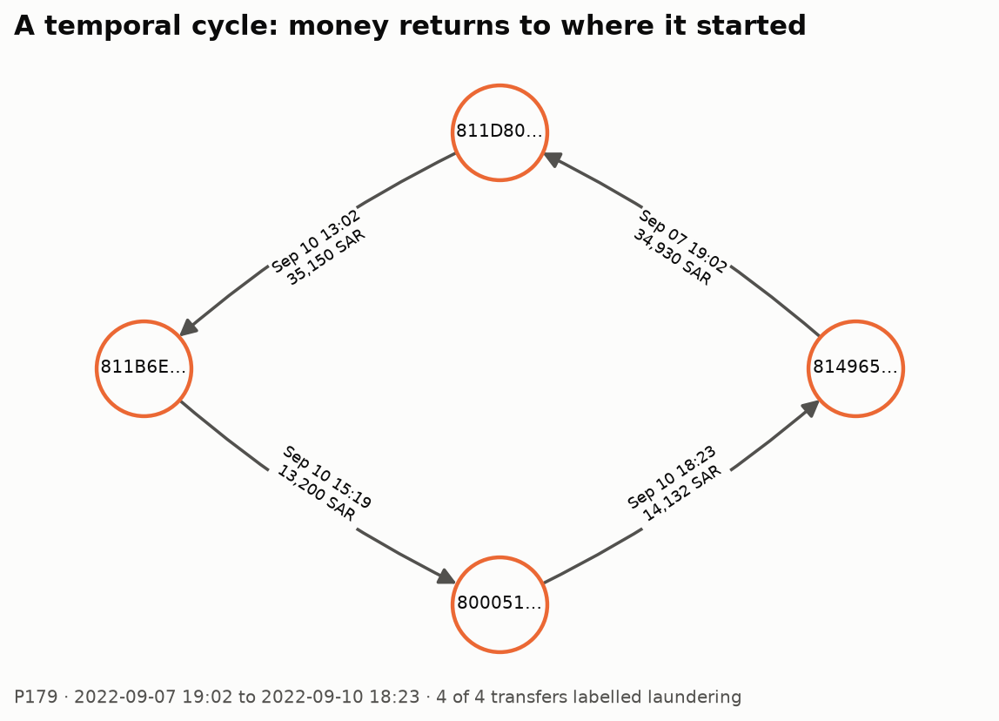
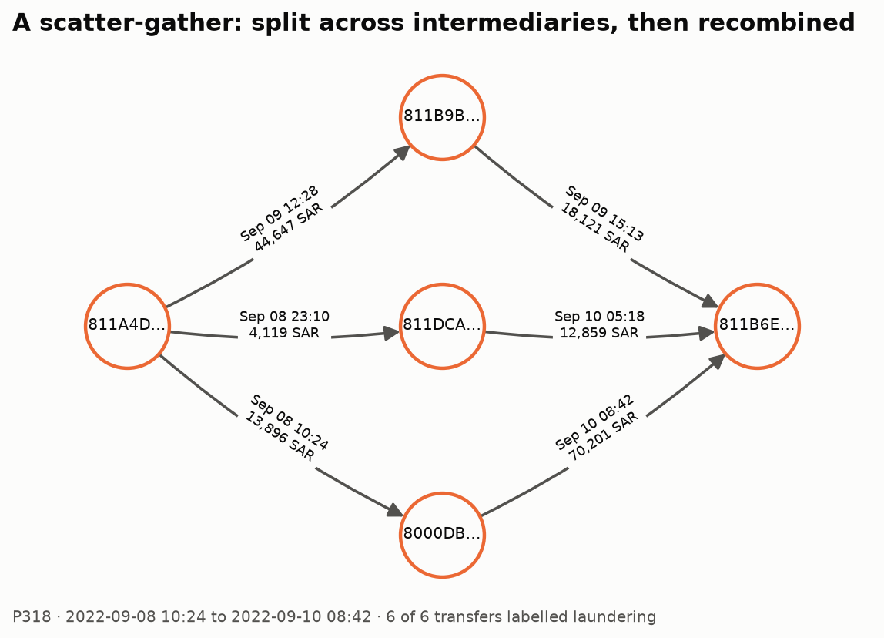
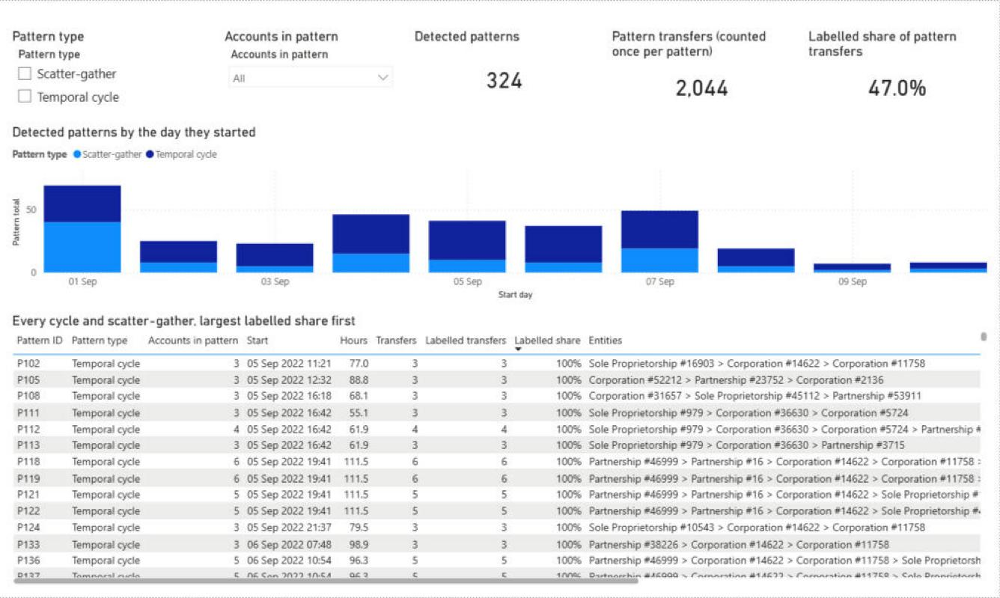
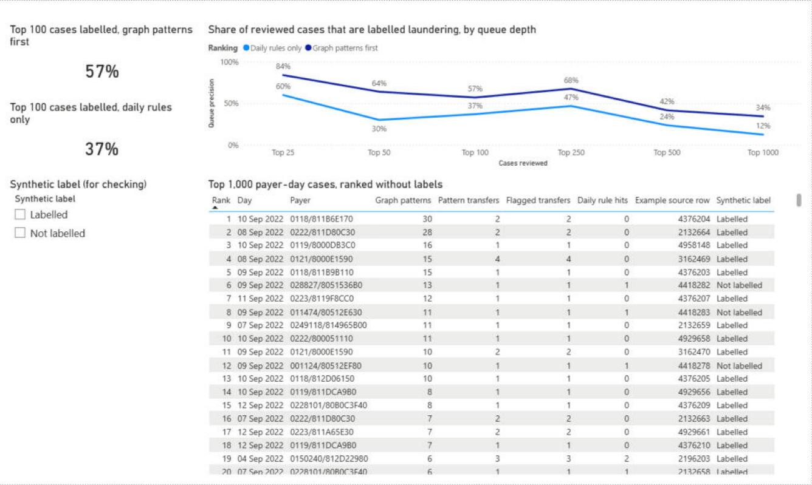
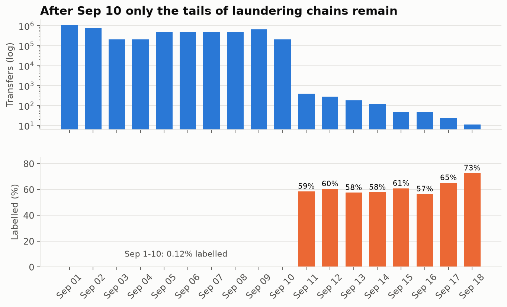

<picture><source media="(prefers-color-scheme: light)" srcset="docs/images/banner-light.svg"></picture>

# AML Graph Intelligence

**Finding money-laundering patterns in 5 million bank transfers by following money between accounts, not just counting transfers per account.**


## The problem

A bank's transaction-monitoring team gets far more alerts than it can review. Simple rules like "this account paid 10 or more people today" fire mostly on payroll, merchants and other busy legitimate accounts. Real laundering hides inside ordinary-looking transfers. Money is **split across intermediaries and recombined** (scatter-gather), or **sent round a loop of accounts back to where it started** (a cycle), often over several days.

This project asks two questions:

1. Do graph patterns find laundering that per-account daily rules miss?
2. If an analyst can only review the top of a queue, how much of that queue is real?

It runs on the **IBM AMLworld HI-Small** synthetic dataset: 5,078,345 transfers between 515,088 accounts over 18 days, of which 5,177 (0.10%) are labelled laundering.

**[Download the Power BI report](powerbi/AML_Review.pbix)** (opens offline in Power BI Desktop) · [Dashboard pages](#power-bi-dashboard)



---

## Contents

- [Headline results](#headline-results)
- [How it works](#how-it-works)
- [What a detected pattern looks like](#what-a-detected-pattern-looks-like)
- [Worked investigation: one network, two views](#worked-investigation-one-network-two-views)
- [Power BI dashboard](#power-bi-dashboard)
- [How the results were checked](#how-the-results-were-checked)
- [Run it](#run-it)
- [Project structure](#project-structure)
- [Limitations](#limitations)

---

## Headline results



**Transfer level.** Each signal is scored against the synthetic label. Lift is precision divided by the 0.10% base rate.

| Signal | Kind | Transfers flagged | Precision | Recall | Lift |
|---|---|---:|---:|---:|---:|
| Fan-out (10+ payees in a day) | daily rule | 506,448 | 0.13% | 13.0% | 1.3× |
| Fan-in (10+ payers in a day) | daily rule | 61,150 | 0.31% | 3.7% | 3.1× |
| Return transfer (A→B after B→A, same day) | daily rule | 568 | 15.3% | 1.7% | 150× |
| **Temporal cycle (3–8 accounts, within 5 days)** | **graph** | **541** | **29.9%** | 3.1% | **294×** |
| **Scatter-gather (3+ intermediaries, within 5 days)** | **graph** | **1,183** | **48.4%** | 11.1% | **474×** |
| Any daily rule | | 568,058 | 0.17% | 18.4% | 1.6× |
| **Any graph pattern** | | **1,705** | **42.3%** | 13.9% | **415×** |
| Any signal | | 569,442 | 0.29% | 31.5% | 2.8× |

The graph patterns flag **0.3% as many transfers** as the daily rules and catch **three-quarters as many** laundering transfers (721 against 952). The two overlap very little, so together they reach 31.5% recall, against 18.4% for the daily rules alone.

**Case level.** A case is one payer account on one day, the unit an analyst would open. A case counts as positive if any of the payer's outgoing transfers that day is labelled. The queue is ranked without looking at labels.

| Review queue | Top 25 | Top 100 | Top 250 | Top 1,000 | Labelled cases reachable |
|---|---:|---:|---:|---:|---:|
| Daily rules only (original queue) | 60% | 37% | 47% | 12% | 10.3% |
| **Graph patterns first, then the original queue** | **84%** | **57%** | **68%** | **34%** | **23.2%** |



On 8–18 September, the period the first version of this project was reported on, the top 100 goes from **33% to 77%**.

---

## How it works



**Daily rules** ([`aml/signals.py`](aml/signals.py)) look at one calendar day at a time. They are the original version of this project, kept as the baseline.

**Graph patterns** look across days at how money moves:

- **Temporal cycle.** Accounts and transfers form a directed graph. `networkx.simple_cycles` lists every loop of 3 to 8 accounts. A loop is a cycle only if real transfers go round it **in time order** and close within 5 days: each hop must happen at or after the previous one. A loop whose hops run backwards in time is a coincidence of the graph, not money coming back.
- **Scatter-gather.** One account pays at least 3 intermediaries. Each intermediary then pays the same final account **after** receiving, within 5 days.

Two steps keep the graph search tractable and focused:

1. **Hub exclusion.** Accounts with more than 30 distinct counterparties over the period are not used as cycle members or intermediaries. They behave like merchants or payroll accounts, and including them multiplies loops without adding signal.
2. **Peeling.** An account on a cycle must both send and receive. Removing the rest repeatedly shrinks the cycle-search graph from 422,734 to about 34,000 accounts.

The full run takes about 2 minutes and 3 GB of memory on a laptop.

**Ranking** ([`aml/evaluation.py`](aml/evaluation.py)) puts every payer-day that belongs to a graph pattern first, ordered by how many patterns and pattern transfers it has. The original daily-rule queue follows, unchanged, so the comparison above is like-for-like.

---

## What a detected pattern looks like

Both examples below come straight from `patterns.csv`, drawn by [`make_charts.py`](make_charts.py). Every transfer in them is labelled laundering.





---

## Worked investigation: one network, two views

The top case in the queue is account `0118/811B6E170` (Partnership #6126) on 10 September. It sits in **39 detected patterns** (36 cycles and 3 scatter-gathers). It is the final account of the scatter-gather above and a member of the cycle above it.

Following those patterns outward gives a network of **16 accounts and 42 transfers** between 2 and 17 September, almost all in Saudi riyals. **38 of the 42 transfers carry the laundering label.**

**Only 1 of those 42 transfers triggers any daily rule.** None of the accounts pays or receives from 10 different accounts in a single day, so fan-in and fan-out never fire. The money also takes days, not hours, to come back, so the same-day return rule misses it too. Seen one day at a time this network is invisible. Seen as a graph across days it is the first thing in the queue.

Reproduce it:

```bash
python investigate.py P179       # the 4-account cycle: 4 transfers, Sep 7 19:02 to Sep 10 18:23
python investigate.py P318       # the scatter-gather that ends at the same account
python investigate.py 4929658    # one transfer, by its line number in HI-Small_Trans.csv
```

```text
P179: cycle across 4 accounts, 2022-09-07 19:02 to 2022-09-10 18:23 (71.3 h)
Accounts: 0249118/814965B00 > 0222/811D80C30 > 0118/811B6E170 > 0222/800051110
Entities: Partnership #16 > Corporation #14622 > Partnership #6126 > Partnership #39
4 of 4 transfers carry the synthetic laundering label.

 source_row             time             payer             payee      paid payment_currency format  label
    2132659 2022/09/07 19:02 0249118/814965B00    0222/811D80C30 34,929.54      Saudi Riyal    ACH      1
    2132666 2022/09/10 13:02    0222/811D80C30    0118/811B6E170 35,150.22      Saudi Riyal    ACH      1
    4929657 2022/09/10 15:19    0118/811B6E170    0222/800051110 13,199.87      Saudi Riyal    ACH      1
    4929658 2022/09/10 18:23    0222/800051110 0249118/814965B00 14,131.83      Saudi Riyal    ACH      1
```

---

## Power BI dashboard

[`powerbi/AML_Review.pbix`](powerbi/AML_Review.pbix) has three pages. It reads seven small tables in [`data/processed/powerbi/`](data/processed/powerbi/) (about 160 KB in total), so it opens and refreshes without the 476 MB raw file. Its source is also stored as a Power BI project ([`AML_Review.pbip`](powerbi/AML_Review.pbip)), so the model and every visual are readable JSON under version control.

**1. Overview** *(screenshot at the top of this page)*. The headline cards (5,078,345 transfers, 0.10% base rate, 42.3% graph-pattern precision against 0.17% for the daily rules, 415× lift), precision for every signal, precision by period, and the daily labelled share that explains the Sep 11–18 tail.

**2. Detected patterns.** All 324 cycles and scatter-gathers, filterable by pattern type and by number of accounts, with the day each pattern started. The table lists every pattern's accounts, entities, time span and how many of its transfers carry the label. Pattern IDs match `patterns.csv` and `python investigate.py P179`.



**3. Review queue.** Precision at each queue depth for both rankings (57% against 37% at the top 100), and the top 1,000 payer-day cases in ranked order. Each case has an example source row to open with `investigate.py`. The synthetic-label filter is there for checking only; the ranking never uses it.



**Refreshing on another computer.** Run `python export_powerbi.py` after `analyze.py` to rebuild the tables. In Power BI Desktop choose **Transform data → Edit parameters**, set **DataFolder** to the absolute path of this repository's `data/processed` folder, then select **Refresh**.

---

## How the results were checked

**Labels are only read after detection.** `aml/signals.py` never touches the label column, and a test confirms the output is the same whether the inputs are labelled 0 or 1. Labels enter only in `aml/evaluation.py`, to score what was already flagged.

**Tests** ([`tests/`](tests/)). 31 tests on small hand-built graphs where the right answer is obvious:

- a cycle in time order is found, from any starting account
- a loop whose hops run backwards in time is rejected
- a cycle must close inside the window, and may cross midnight
- cycles over the length limit are ignored, and hub accounts are excluded
- scatter-gather needs 3 intermediaries, and each must forward *after* receiving
- fan rules count distinct counterparties, not payments, and reset each day
- self-transfers never trigger a signal
- the metric arithmetic is checked by hand, and the new queue keeps the original order after the pattern cases

**The 13–18 September "zero candidates" puzzle.** The first version of this README reported 163 labelled cases and zero candidates in that period. It was not a bug in the rules; it was the data:



The simulator stops generating normal activity after 10 September. The remaining 1,108 transfers are the tails of laundering chains still in progress, 59% of them labelled. With so few transfers a day no account reaches 10 counterparties, so the daily rules fire 3 times in 8 days. Graph patterns look across days, so they still work: in the tail they flag 166 transfers at **83% precision**.

**Stable across periods.** The graph patterns are not carried by one lucky stretch of days:

| Period | Transfers | Labelled | Daily rules: precision / recall | Graph patterns: precision / recall |
|---|---:|---:|---|---|
| Sep 1–5 | 2,766,832 | 1,999 | 0.17% / 24.0% | 27.4% / 9.9% |
| Sep 6–10 | 2,310,405 | 2,523 | 0.17% / 18.6% | 47.1% / 15.3% |
| Sep 11–18 (tail) | 1,108 | 655 | 100% / 0.5% (3 flags) | 83.1% / 21.1% |

**Sensitivity.** How the two graph settings trade precision for coverage:

| Setting | Flagged | Precision | Recall |
|---|---:|---:|---:|
| Cycles up to 4 accounts | 449 | 23.2% | 2.0% |
| Cycles up to 6 accounts | 495 | 25.1% | 2.4% |
| **Cycles up to 8 accounts (used)** | **541** | **29.9%** | **3.1%** |
| Scatter-gather, 2+ intermediaries | 97,859 | 0.8% | 15.4% |
| **Scatter-gather, 3+ intermediaries (used)** | **1,183** | **48.4%** | **11.0%** |
| Scatter-gather, 4+ intermediaries | 662 | 78.9% | 10.1% |
| Scatter-gather, 5+ intermediaries | 592 | 86.7% | 9.9% |

Two intermediaries is just "A paid two people who both paid B", which is common, so the minimum of 3 is where the pattern starts to mean something.

All of these figures are written to [`data/processed/evaluation.json`](data/processed/evaluation.json) and [`data/processed/case_evaluation.json`](data/processed/case_evaluation.json). Every detected pattern is listed in [`data/processed/patterns.csv`](data/processed/patterns.csv).

---

## Run it

**1. Get the data.** Download the [IBM Transactions for Anti Money Laundering dataset from Kaggle](https://www.kaggle.com/datasets/ealtman2019/ibm-transactions-for-anti-money-laundering-aml) (free account needed). Put `HI-Small_Trans.csv` (476 MB) and `HI-Small_accounts.csv` in `data/raw/`. The dataset is described in Altman et al., [*Realistic Synthetic Financial Transactions for Anti-Money Laundering Models*](https://arxiv.org/abs/2306.16424) (NeurIPS 2023).

**2. Run.** Python 3.11+ (pandas 3 needs it).

```bash
python -m venv .venv && .venv\Scripts\activate     # macOS/Linux: source .venv/bin/activate
python -m pip install -r requirements.txt
python -m pytest -q          # 31 tests, no data needed
python analyze.py            # about 2 minutes: signals, patterns, evaluation
python make_charts.py        # README figures -> docs/images/
python export_powerbi.py     # Power BI tables -> data/processed/powerbi/
python investigate.py P179   # evidence for a pattern or a transfer
```

### Outputs (`data/processed/`)

| File | Contents | Committed |
|---|---|---|
| `evaluation.json` | Precision, recall and lift per signal, per period, per day, and the sensitivity runs | yes |
| `case_evaluation.json` | Precision@k of both review queues, for all days and for Sep 8–18 | yes |
| `patterns.csv` | Every detected cycle and scatter-gather: accounts in order, entities, time span, source rows | yes |
| `alerts.csv` | One row per flagged transfer with every signal and its pattern IDs (75 MB) | no, regenerate |
| `ranked_cases.csv` | The payer-day review queue in ranked order | no, regenerate |
| `powerbi/*.csv` | Seven small tables for the Power BI report: summary, signals, periods, days, queue depths, top 1,000 cases, patterns | yes |

---

## Project structure

```text
aml-graph-intelligence/
├── aml/
│   ├── data.py          # load HI-Small into a compact frame; account and entity lookups
│   ├── signals.py       # daily rules, temporal cycles, scatter-gather (labels never read)
│   └── evaluation.py    # precision/recall/lift, payer-day cases, ranking, precision@k
├── analyze.py           # runs everything and writes data/processed/
├── investigate.py       # prints the evidence behind a pattern or a transfer
├── make_charts.py       # README figures
├── export_powerbi.py    # small tables for the Power BI report
├── powerbi/             # AML_Review.pbix and its project source (.pbip)
├── tests/
│   ├── test_signals.py      # hand-built graphs for every signal
│   └── test_evaluation.py   # metric arithmetic and queue ordering
├── data/processed/      # committed evaluation results, pattern list and Power BI tables
└── docs/images/         # README figures and Power BI screenshots
```

---

## Limitations

- **Synthetic labels.** AMLworld is generated by a simulator with known laundering typologies, and cycles and scatter-gathers are among them. Real laundering is messier, and real labels come from investigations and suspicious activity reports, not from a simulator.
- **No separate tuning split.** The graph settings (3 intermediaries, up to 8 accounts, 5 days, 30-counterparty hub limit) were fixed after one exploratory run over the full data. The ranking order was revised once after the first full run: daily-rule overlap had been interleaved with graph evidence and was hurting it. The numbers are therefore somewhat optimistic. The sensitivity and per-period tables show how much they move.
- **Many patterns are still false positives.** Transfer-level precision for cycles is 30%. 55% of detected cycles contain no labelled transfer at all: legitimate money also goes round loops.
- **Hubs are blind spots.** Laundering routed through an account with more than 30 counterparties will not appear as a cycle or scatter-gather.
- **Amounts are not used.** A laundering cycle usually loses a little at each hop (fees, smurfing). Checking that amounts shrink round the loop would cut false positives, and is the obvious next step.
- **Retrospective.** The queue ranks a whole month at once. It does not simulate a daily review budget or alerts arriving in real time.

## Author

Built by [Amaan Shaikh](https://amaanshaikh.dev), fintech data analyst. More projects and résumé at [amaanshaikh.dev](https://amaanshaikh.dev).
